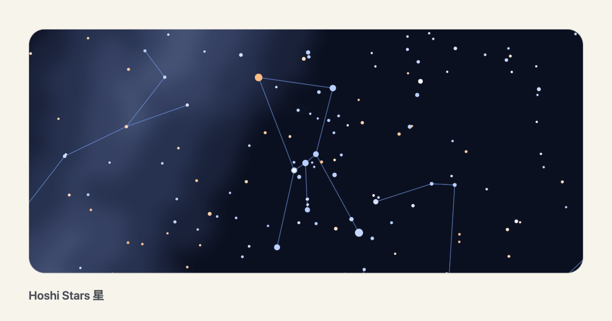
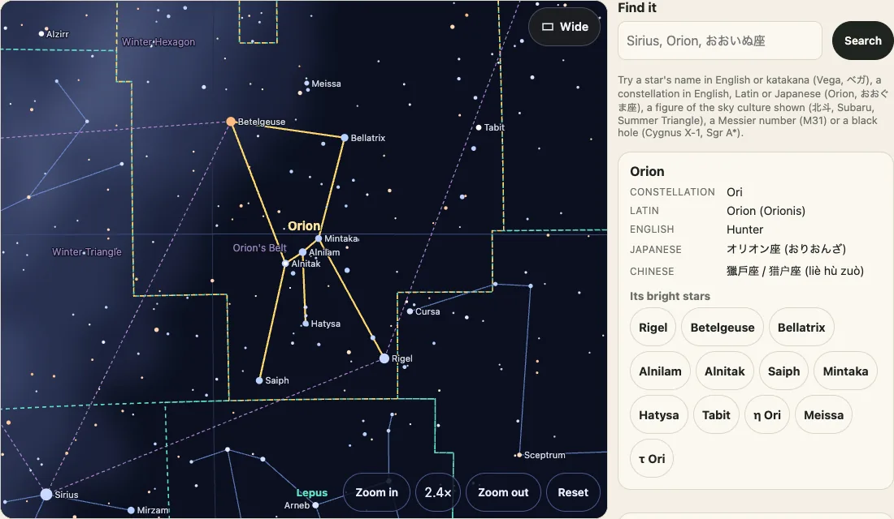
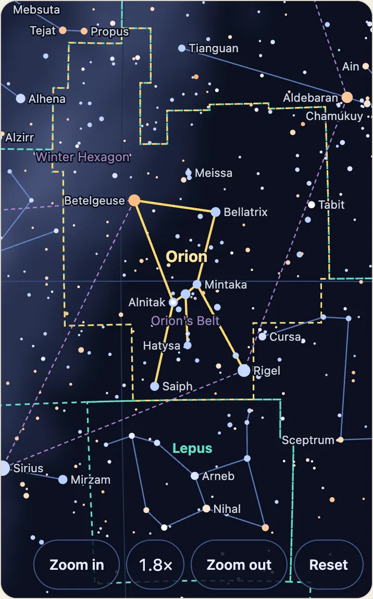
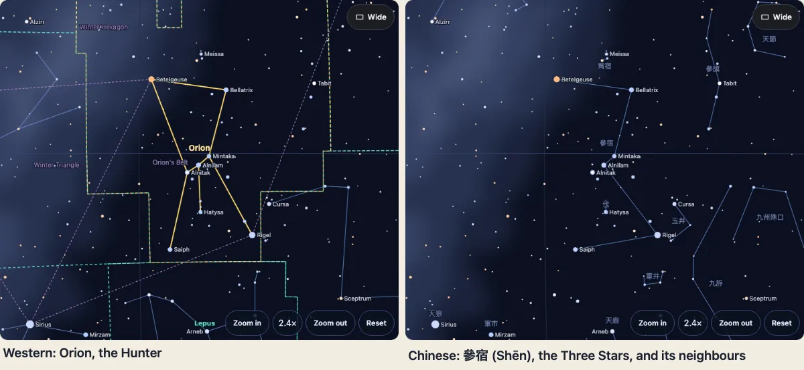

<p align="center"><a href="https://johnmorrisdotca.github.io/hoshi-stars/"><picture><source media="(prefers-color-scheme: dark)" srcset="https://raw.githubusercontent.com/johnmorrisdotca/hoshi-stars/main/docs/images/thumbnail-dark.png"></picture></a></p>

# Hoshi Stars 星

<p>Part of <strong>Space Program X (SPX)</strong>, the space packages: <a href="https://github.com/johnmorrisdotca/wakusei-planets">Wakusei Planets</a> · <a href="https://github.com/johnmorrisdotca/hoshi-stars">Hoshi Stars</a> · <a href="https://github.com/johnmorrisdotca/chikyu-earth">Chikyu Earth</a> · <a href="https://github.com/johnmorrisdotca/uchusen-rockets">Uchusen Rockets</a></p>

**[Open the demo](https://johnmorrisdotca.github.io/hoshi-stars/)**: a sky chart you turn, zoom and search, in English and Japanese. It runs in the browser of a phone, a tablet or a computer: nothing to install, no account, and it is free.

**The same stars, seen three ways:** the 88 Western constellations, the traditional Japanese names and figures, and the Chinese Three Enclosures and Twenty-Eight Mansions (三垣二十八宿), with names in English, Japanese and Chinese. It is a way to learn and to compare, not an authority on any tradition.

<p align="center"> </p>

<p align="center"></p>

The limits of that picture, in plain words: the lines of the Chinese figures are our own joins, not the traditional drawings; a figure with stars fainter than magnitude 6.0 is drawn short, and its card says how many stars are missing; and the Chinese asterisms are read from Wikidata. More in [Sky cultures](#sky-cultures) and [Limits](#limits).

## Who it is for

- **Teachers and students:** a chart that turns and zooms in any browser, and [sheets to print](https://johnmorrisdotca.github.io/hoshi-stars/kids.html) in English and Japanese: connect-the-dots constellations, a star wheel to cut out, a sky map for each month and the constellations for where you live.
- **Stargazers and space enthusiasts:** [the constellations for your latitude this month](https://johnmorrisdotca.github.io/hoshi-stars/kids.html?kind=guide&lat=45), [the Andromeda Galaxy](https://johnmorrisdotca.github.io/hoshi-stars/?pick=D:M31&layers=milky,lines,names,deep) among the deep-sky objects, [Cygnus X-1](https://johnmorrisdotca.github.io/hoshi-stars/?pick=B:Cygnus%20X-1&layers=milky,lines,names,holes) among the black holes, and [the sky from another star](https://johnmorrisdotca.github.io/hoshi-stars/?from=HR5459).
- **Researchers and outreach staff:** distances come with their error, a star's size and temperature with their uncertainty, and every source is named in [NOTICE.md](NOTICE.md). The tables download as CSV and Parquet ([data files](docs/guides/data-files.md)). Read [Limits](#limits) first, and see [How to cite](#how-to-cite).
- **People who come through the zodiac:** the twelve zodiac constellations are real star patterns along the Sun's path, and that path also crosses a thirteenth, Ophiuchus, so the dates the Sun is in each one no longer match the traditional sign dates. See [Ophiuchus](https://johnmorrisdotca.github.io/hoshi-stars/constellation.html?c=Oph), or [all 88](https://johnmorrisdotca.github.io/hoshi-stars/constellations.html), with their stars and their names in three cultures.
- **People learning or teaching Japanese or Chinese, and readers in Japan and China:** every constellation named in English, Japanese (with its hiragana reading) and Chinese (Traditional, Simplified and pinyin), and [the Japanese sky](https://johnmorrisdotca.github.io/hoshi-stars/?culture=japanese&go=Ori) and [the Chinese sky](https://johnmorrisdotca.github.io/hoshi-stars/?culture=chinese&ra=83.97&dec=-1.69&zoom=6.7) under the names you know.
- **Site owners and developers:** the demo's "Put it in your page" panel writes the `<iframe>` for a chart, with no build step; and the stars, constellations, Messier objects and seven projections are typed data with no dependencies, one import for each. The install and the API are below.

## Try it now, nothing to install

**Learn:** **[Sheets to print](https://johnmorrisdotca.github.io/hoshi-stars/kids.html)** · **[Your sky from a place](https://johnmorrisdotca.github.io/hoshi-stars/kids.html?kind=guide&lat=45)** (a sheet of the constellations for your latitude this month: pick your country, or tap Use my location) · **[The 88 constellations, a picture of each](https://johnmorrisdotca.github.io/hoshi-stars/constellations.html)**

**Look:** **[Orion on the sky chart](https://johnmorrisdotca.github.io/hoshi-stars/?go=Ori)** · **[The Andromeda Galaxy](https://johnmorrisdotca.github.io/hoshi-stars/?pick=D:M31&layers=milky,lines,names,deep)** · **[Cygnus X-1](https://johnmorrisdotca.github.io/hoshi-stars/?pick=B:Cygnus%20X-1&layers=milky,lines,names,holes)** · **[The sky from another star](https://johnmorrisdotca.github.io/hoshi-stars/?from=HR5459)** (Alpha Centauri)

**Three skies:** **[Western](https://johnmorrisdotca.github.io/hoshi-stars/?go=Ori)** · **[Japanese](https://johnmorrisdotca.github.io/hoshi-stars/?culture=japanese&go=Ori)** · **[Chinese](https://johnmorrisdotca.github.io/hoshi-stars/?culture=chinese&ra=83.97&dec=-1.69&zoom=6.7)** · **[日本語](https://johnmorrisdotca.github.io/hoshi-stars/?lang=ja)** · **[English](https://johnmorrisdotca.github.io/hoshi-stars/?lang=en)**

## For teachers and families

Hoshi Stars works on a phone or a tablet as well as on a computer, in the browser, and it is free: the code is MIT-licensed, and nothing is installed or signed up for. [The sheets guide](https://johnmorrisdotca.github.io/hoshi-stars/docs/guides/printable-sheets.html) says what each printable sheet is, and [the sky-charts guide](https://johnmorrisdotca.github.io/hoshi-stars/docs/guides/sky-charts.html) shows how to put a chart on your own page. Every source is credited in [NOTICE.md](NOTICE.md) and at the foot of each demo page.

```sh
npm install @johnmorrisdotca/hoshi-stars
```

```ts
import { starByName, starColour, starDistanceLightYears, starPosition, stars } from "@johnmorrisdotca/hoshi-stars";

const sirius = starByName("Sirius")!;
console.log(sirius.designation, sirius.magnitude, starColour(sirius));          // α CMa -1.46 #c9daff
console.log(starDistanceLightYears(sirius)?.toFixed(1), "light-years");          // 8.5 light-years
console.log(starPosition(starByName("Arcturus")!, Date.UTC(2100, 0, 1)).rightAscension.toFixed(1));   // 213.9
console.log(stars({ magnitude: 2 }).length, "stars as bright as magnitude 2");    // 50 stars as bright as magnitude 2
```

| Function | Gives |
|---|---|
| `stars({ magnitude? })` | the stars as bright as a magnitude, brightest first |
| `starByHr(hr)`, `starByName(text)` | one star by its Bright Star Catalogue number, or its name (English or katakana) or designation |
| `starPosition(star, when?)` | right ascension and declination (degrees, J2000 frame) carried by proper motion |
| `starDistanceLightYears(star)` | the distance from the parallax |
| `starDistance(star)` | the distance with its error and its nearest and farthest |
| `luminosityClass(spectralType)` | the luminosity class in a spectral type: `Ia`, `III`, `V` |
| `starTemperatureK(bv)`, `blackBodyColour(kelvin)`, `starColour(star)` | temperature and a colour to draw |

Counts: 15 stars to magnitude 1, 50 to 2, 174 to 3, 518 to 4, 1,630 to 5 and 5,080 to 6.

## The 88 constellations

Their own import, about 2 kB gzipped, so the bright-star entry stays small. Each has its IAU abbreviation, Latin name and genitive, English name, and Japanese name with its hiragana reading (`おおいぬ座`, `おおいぬざ`).

```ts
import { constellation, constellations, starsIn } from "@johnmorrisdotca/hoshi-stars/constellations";

const dog = constellation("CMa")!;            // or "Canis Major", "Great Dog", "おおいぬ座", in any case
console.log(dog.name, dog.genitive, dog.english, dog.japanese, dog.reading);   // Canis Major Canis Majoris Great Dog おおいぬ座 おおいぬざ
console.log(constellations().length);                                          // 88
console.log(starsIn("Ori").slice(0, 2).map((s) => s.name));                   // [ 'Rigel', 'Betelgeuse' ]
```

| Function | Gives |
|---|---|
| `constellations()` | all 88, alphabetical by Latin name |
| `constellation(text)` | one, by abbreviation, Latin name, genitive, English name, Japanese name or reading; `undefined` if none |
| `starsIn(text)` | the bright stars that lie in it, brightest first (`RangeError` for a text that is no constellation) |

## Pictures of the constellations

Each of the 88 has a picture drawn from this package's own stars, lines and boundaries, in a light and a dark look, with its neighbours faint round it and no text in the drawing. The package ships them as files, `thumbnails/svg/dark/Ori.svg` and `thumbnails/png/160/light/Ori.png` (the demo site also has 480 and 1200 pixel PNGs), and `@johnmorrisdotca/hoshi-stars/thumbnails` draws any of them, or any other set of figures, as an SVG string. `@johnmorrisdotca/hoshi-stars/constellation-facts` adds what a gallery or a list needs: the meaning, hemisphere, best month, origin, how easy it is to find, asterisms and meteor showers. See [Constellation pictures and facts](docs/guides/constellation-pictures.md).

The picture files are about 5 MB of the installed package (2.9 MB of SVG, 2.3 MB of 160-pixel PNG), on disk only: no entry point imports them, so a bundle or a page never carries them unless it links to one, and `@johnmorrisdotca/hoshi-stars/thumbnails` is the drawing code alone.

```ts
import { allConstellationFacts } from "@johnmorrisdotca/hoshi-stars/constellation-facts";
import { constellationThumbnail } from "@johnmorrisdotca/hoshi-stars/thumbnails";

const svg = constellationThumbnail("Ori", { theme: "light", size: 160 });
console.log(svg.startsWith("<svg"), allConstellationFacts().filter((f) => f.meteorShowers.length > 0).length); // true 11
```

## The whole sky on one map

`@johnmorrisdotca/hoshi-stars/all-sky` fits the whole sky into a box twice as wide as it is tall, in Mollweide, Hammer or plate carrée, galactic (the Galaxy's centre in the middle, the Milky Way along it) or equatorial, and cuts a line at the seam so that it ends on the edge at both sides. The demo's `whole-sky.html` draws all 88 constellations on it with names in English and Japanese, zooms with the family's controls, opens a constellation on the sky map when you tap it, and prints as a page or a poster. See [The whole sky on one map](docs/guides/whole-sky.md).

```ts
import { allSkyLine, allSkyProject } from "@johnmorrisdotca/hoshi-stars/all-sky";
import { boundaryOf } from "@johnmorrisdotca/hoshi-stars/boundaries";

const centre = allSkyProject({ rightAscension: 266.4168, declination: -29.0078 }, { width: 1000 });
console.log(Math.round(centre.x), Math.round(centre.y));                                  // 500 250
console.log(allSkyLine(boundaryOf("Aur").outlines[0]!, { width: 1000 }).length >= 1);     // true
```

## Which constellation, and the boundaries

`@johnmorrisdotca/hoshi-stars/boundaries` is its own import. `constellationAt` says which of the 88 constellations a position is in; `boundaryOf` and `boundaries` give the boundary lines to draw. The boundaries are the IAU's (Delporte 1930) as N. G. Roman (1987) tabulated them on the equinox of B1875.0 (VizieR VI/42); a position is precessed to B1875.0 first, with the IAU 1976 angles from Meeus.

```ts
import { starByName } from "@johnmorrisdotca/hoshi-stars";
import { boundaryOf, constellationAt } from "@johnmorrisdotca/hoshi-stars/boundaries";

console.log(constellationAt(starByName("Betelgeuse")!).name);                          // Orion
console.log(constellationAt({ rightAscension: 0, declination: 90 }).abbreviation);      // UMi
console.log(constellationAt({ rightAscension: 135, declination: 65 }, Date.UTC(1950, 0, 1)).abbreviation);   // a position of date: UMa
const outline = boundaryOf("Cru").outlines[0]!;    // closed, J2000 degrees, first point repeated as the last
console.log(outline.length, outline[0]);
```

| Function | Gives |
|---|---|
| `constellationAt(position, when?)` | the `Constellation` the J2000 position is in (a position of date when `when` is given); `TypeError` or `RangeError` for bad input |
| `boundaryOf(text, { step? })` | one constellation's `outlines`: closed rings of `{ rightAscension, declination }` in J2000 degrees (Serpens has two) |
| `boundaries({ step? })` | all 88, in the order of `constellations()` |

- Every edge of the boundaries runs along a line of constant right ascension or constant declination on B1875.0, which after precession is a slightly tilted curve. Each edge is cut into pieces of at most `step` degrees of arc (1 by default, 0.01 to 90), so the whole sky is about 9,700 points at the default; join them with straight lines, and project each point (a ring that crosses 0 h jumps from near 360 to near 0 in raw degrees).
- Checked against Roman's own 8 test positions, every one of the 2,736 bright stars whose catalogue entry names a constellation (all agree), and the areas the IAU lists (Hydra 1302.8, Crux 68.4 square degrees; the 88 add up to the whole sky, 41,253).
- A point within a few arc-seconds of a boundary can fall either side: the table is to a hundredth of a second of time and the precession is the modern one, not 1930's.
- About 7 kB gzipped of data on top of the constellations table, and 100,000 lookups take about 40 ms.

## Constellation lines

`@johnmorrisdotca/hoshi-stars/lines` is its own import, about 2 kB gzipped, so a chart without lines pays nothing. Each of the 88 constellations has a stick figure: pairs of its bright stars to join with a line. The figures are our own, decided from the star data (`NOTICE.md`); every star of a line lies inside the constellation, so one figure never runs into the next.

```ts
import { figureOf, figures } from "@johnmorrisdotca/hoshi-stars/lines";

const orion = figureOf("Ori");               // or "Orion", "Hunter", "オリオン座"
console.log(orion.stars.length, orion.segments.length);
for (const [a, b] of orion.segments) console.log(a.name ?? a.designation, "to", b.name ?? b.designation);
console.log(figures().length);               // 88
```

| Function | Gives |
|---|---|
| `figures()` | all 88 figures, in the order of `constellations()` |
| `figureOf(text)` | one, by any name `constellation` accepts: its `constellation`, the `stars` it uses and the `segments` (pairs of stars) to draw (`RangeError` for a text that is no constellation) |

- Project each star with `/projection` and draw each pair as a line. On a wide projection (equirectangular, Mollweide, Hammer) skip a line whose two ends land more than half the chart apart: it crosses the edge.
- A figure with one star and no lines is allowed where a figure makes no sense; every constellation at this version has lines.

## Sky cultures

The same stars under other figures and names. `constellations`, `constellation`, `starsIn`, `figures` and `figureOf` take a culture as an extra argument, and leave out they give the 88 constellations of the IAU, as before. Each culture is its own import: `/cultures/western` (the 88 with their names in Latin, English, Japanese and Chinese, Simplified and Traditional, with pinyin, and 17 asterisms such as the Big Dipper and the Summer Triangle), `/cultures/japanese` (the 88 under their Japanese names and 18 traditional names and figures: 昴 Subaru, 北斗七星, 鼓星, 織姫 and 彦星, with readings) and `/cultures/chinese` (三垣二十八宿, the Three Enclosures and the Twenty-Eight Mansions: 238 asterisms with Traditional and Simplified names and pinyin).

```ts
import { constellation, starsIn } from "@johnmorrisdotca/hoshi-stars/constellations";
import { figureOf } from "@johnmorrisdotca/hoshi-stars/lines";
import { chinese } from "@johnmorrisdotca/hoshi-stars/cultures/chinese";
import { japanese } from "@johnmorrisdotca/hoshi-stars/cultures/japanese";

console.log(constellation("北斗", chinese)!.readings.zh, starsIn("beidou", chinese).length);   // běi dǒu 7
console.log(figureOf("すばる", japanese).asterism.names.en, figureOf("羽林軍", chinese).asterism.missing); // Subaru 32
```

| Name | Gives |
|---|---|
| `western`, `japanese`, `chinese` | a `Culture`: `id`, `names`, `asterisms()` and `find(text)` |
| `Asterism` | one figure: `id`, `name`, `names` (by `NameLanguage`: `la`, `en`, `ja`, `zh-Hans`, `zh-Hant`), `readings` (`ja` in hiragana, `zh` in pinyin), `aka`, `about`, `kind` (an `AsterismKind`: `constellation`, `asterism` or `mansion`), `group`, `missing` and `chains` of HR numbers |
| `CultureFigure` (`/lines`) | an `Asterism` with its `stars` and `segments`: only the stars of the figure that the catalogue holds |
| `defineCulture(id, names, make)` (`/culture`) | a culture of your own |

A Chinese asterism with stars fainter than magnitude 6.0 draws only the stars we have, and `missing` says at least how many it lacks. The lines of the Chinese figures are our own joins, not the traditional drawing. The Chinese asterisms are read from Wikidata (CC0); Stellarium's sky-culture files (GPL, CC BY-SA) are not used (`NOTICE.md`). The demo has a **Sky culture** choice, kept in the address as `culture=chinese`, and picking a figure shows its card. [Sky cultures](https://johnmorrisdotca.github.io/hoshi-stars/docs/) has the details.

Docs: https://johnmorrisdotca.github.io/hoshi-stars/docs/ , with a Japanese page for every guide. The embed page is https://johnmorrisdotca.github.io/hoshi-stars/embed.html .

## Map projections

`@johnmorrisdotca/hoshi-stars/projection` turns a sky position into a point on a flat chart, and back. Pure maths, no dependencies, and a page that does not import it does not pay for it. The kinds are `stereographic`, `orthographic`, `gnomonic`, `equidistant`, `equirectangular`, `mollweide` and `hammer` (Hammer-Aitoff).

```ts
import { starByName, starPosition } from "@johnmorrisdotca/hoshi-stars";
import { project, unproject } from "@johnmorrisdotca/hoshi-stars/projection";

const options = { centre: { rightAscension: 83.8, declination: -5.4 }, scale: 300 };   // Orion in the middle
const betelgeuse = project("stereographic", starPosition(starByName("Betelgeuse")!), options);
console.log(betelgeuse!.x.toFixed(1), betelgeuse!.y.toFixed(1));            // -26.3 67.4
console.log(unproject("stereographic", betelgeuse!, options).rightAscension.toFixed(1));   // 88.8
```

- `x` runs right and `y` runs up. The default is the sky seen looking up: north is up and east is to the LEFT, so `x` grows toward decreasing right ascension. Pass `mirror: true` for the map convention, east right.
- `project` gives `undefined` for a point that is not on the visible side (the far hemisphere of `orthographic` and `gnomonic`, the antipode of `stereographic`). `unproject` gives `undefined` outside the map.
- `scale` is the radius of the sky in drawing units (default 1). `rotation` turns the chart anticlockwise, in degrees. For `equirectangular` to give degrees, pass `scale: 180 / Math.PI`.
- `mollweide` and `hammer` are equal-area ovals of the whole sky, 2 sqrt(2) by sqrt(2) times `scale`, turned so the centre is the middle.
- A million projections take 50 to 230 ms on a laptop (Mollweide is the slowest). The formulas are from J. P. Snyder, *Map Projections: A Working Manual* (USGS Professional Paper 1395, 1987).

## Your sky, and the sky from another planet

`@johnmorrisdotca/hoshi-stars/sky` says where a star stands over your head: its altitude above the horizon and its azimuth (degrees from north through east) at a place and a moment. Pure maths, no dependencies, and a page that does not import it does not pay for it.

```ts
import { starByName, starPosition } from "@johnmorrisdotca/hoshi-stars";
import { horizontal, isAboveHorizon, localSiderealTime } from "@johnmorrisdotca/hoshi-stars/sky";

const vancouver = { latitude: 49.28, longitude: -123.12 };   // degrees north, degrees east
const now = new Date("2026-11-08T06:00:00Z");
console.log(horizontal(starPosition(starByName("Sirius")!), vancouver, now)); // { altitude: ..., azimuth: ... }
console.log(horizontal(starPosition(starByName("Polaris")!), vancouver, now).altitude); // 49.8: within a degree of your latitude
console.log(isAboveHorizon(starPosition(starByName("Sirius")!), vancouver, now));
console.log(localSiderealTime(now, vancouver.longitude));      // the right ascension on your meridian
```

- `horizontal(position, observer, when, options?)` takes a J2000 position (any `{ rightAscension, declination }` in degrees, such as `starPosition(star)`), carries it to the date (`precess`, IAU 1976), finds the hour angle from the local mean sidereal time (`greenwichSiderealTime`, IAU 1982) and returns `{ altitude, azimuth }`. A position that is already of the date (a planet from an almanac) takes `equinox: "date"`.
- The altitude is geometric. `refraction: true` adds the bending of light by the air (Saemundsson's formula: about 0.48 degree at the horizon, 0.017 at 45 degrees up, none at the zenith), with `pressureHpa` (default 1010) and `temperatureC` (default 10); it is not applied below -1 degree. `isAboveHorizon` takes the same options.
- Accuracy: about an arc-minute. UTC stands for UT, and nutation, aberration, parallax and the star's own proper motion (add it with `starPosition(star, when)`) are left out. `heightM` is checked but changes nothing for a star.

### From another planet

The sky of another planet turns about that planet's own pole. `horizontalFrom(position, spin, observer, when)` takes the pole and prime meridian as the IAU Working Group on Cartographic Coordinates and Rotational Elements (WGCCRE) gives them, so the planet data stays with you (this package never imports wakusei-planets):

```ts
import { starByName, starPosition } from "@johnmorrisdotca/hoshi-stars";
import { horizontalFrom } from "@johnmorrisdotca/hoshi-stars/sky";

// Mars, IAU 2015 values at J2000: pole right ascension and declination, and W = w0 + rate * days since J2000
const mars = { pole: { rightAscension: 317.269202, declination: 54.432516 }, primeMeridian: { w0: 176.049863, rate: 350.891982443297 } };
const deneb = starPosition(starByName("Deneb")!);
console.log(horizontalFrom(deneb, mars, { latitude: 90, longitude: 0 }, new Date()).altitude.toFixed(1)); // 79.8
```

- **The stars look the same from every planet.** The nearest star, Proxima Centauri, shifts about 40 arc-seconds seen from Pluto (parallax 0.77 arc-second times 49 AU at the farthest), a typical star far less, so a J2000 position serves anywhere in the solar system. Only the pole and the turning change.
- `rate` is degrees a day and may be negative (Venus and Uranus turn the other way). The pole's slow drift and the periodic terms of the IAU tables are not applied: pass the pole for the date if you want them. The moment is UTC, like every moment here; it is turned into Terrestrial Time inside (leap seconds from 1972, delta T before), which turns Mars by 0.28 degree. A leap second announced after 2017 is not known until the table in `src/time-scale.ts` gets its row. Latitude is the angle from the planet's equator on a sphere.
- A spin equal to the Earth's gives the Earth's sky (pole at declination 90 and right ascension 270, `w0` 280.46061837, `rate` 360.98564736629), apart from the precession since J2000.
- A hundred thousand `horizontal` conversions take about 26 ms on a laptop. The formulas are from J. Meeus, *Astronomical Algorithms* (2nd ed.), chapters 12, 13, 16 and 21.

## Deep-sky objects

Two imports, so a page pays only for what it uses. `@johnmorrisdotca/hoshi-stars/deep-sky` is the 110 Messier objects (about 3 kB gzipped); `@johnmorrisdotca/hoshi-stars/deep-sky/ngc-ic` adds the NGC and IC objects, 11,898 in all (about 220 kB gzipped). Both have the same functions. The data is Wikidata's (CC0), read on 2026-11-08 and checked against NASA/IPAC NED; the numbers are in [NOTICE.md](NOTICE.md).

```ts
import { deepSky, deepSkyObject, messier } from "@johnmorrisdotca/hoshi-stars/deep-sky";

const m31 = deepSkyObject("M31")!;              // or "NGC 224", "Messier 31", "Andromeda Galaxy", in any case
console.log(m31.id, m31.ngc, m31.name, m31.type, m31.magnitude);                  // M31 NGC 224 Andromeda Galaxy galaxy 3.4
console.log(m31.rightAscension.toFixed(3), m31.declination.toFixed(3));           // 10.685 41.269
console.log(messier().length, deepSky({ type: "globular cluster" }).length);      // 110 29
console.log(deepSky({ magnitude: 4 }).map((o) => o.id));                          // [ 'M7', 'M31', 'M42', 'M44', 'M45' ]
```

| Function | Gives |
|---|---|
| `messier()` | the 110, M1 to M110 (in `/deep-sky` only) |
| `deepSky({ catalogue?, magnitude?, type? })` | the objects that meet the options, in catalogue order: Messier, then NGC, then IC. `catalogue` is `"messier"`, `"ngc"` or `"ic"` (objects with a number in it); `magnitude` the faintest to include |
| `DEEP_SKY_CATALOGUES`, `DEEP_SKY_TYPES` | the catalogue names `catalogue` takes (`"messier"`, `"ngc"`, `"ic"`) and the kinds of object `type` takes |
| `deepSkyObject(text)` | one object by `M31`, `NGC 224`, `IC 434`, any other NGC or IC number it carries, or an English name; `undefined` if none |
| `galaxyDistance(object)` | a galaxy's distance, as the next section says; `null` for anything else or a galaxy with none (`/deep-sky` holds the Messier galaxies only) |

An object has `id`, `messier`, `ngc`, `ic` (each a string such as `"NGC 224"`), `otherIds`, `name`, `type` (`galaxy`, `globular cluster`, `open cluster`, `nebula`, `planetary nebula`, `supernova remnant` or `other`), `constellation` (the IAU abbreviation), `rightAscension` and `declination` (degrees, J2000), `magnitude` (visual, or `undefined`) and `sizeArcmin` (the major axis, or `undefined`).

- **M102** is the Messier object nobody can agree on: Messier's own description fits M101, and the modern lists take it for the galaxy NGC 5866, which is what this table does. **M40** is a double star (Winnecke 4) and **M73** four stars in a row; both are `other`, because Messier listed them.
- **Magnitudes and sizes of the Messier objects** are the published visual magnitudes and major axes of NASA HEASARC's Messier table, because Wikidata's V-band magnitudes for 14 of them are more than a magnitude off (the central star's, for the four planetary nebulae). The NGC and IC magnitudes are Wikidata's, except that a planetary nebula has none (Wikidata's is its central star's); about four in ten have none, and almost none has a size.
- **Positions** are Wikidata's. Every Messier object was compared with NED and a sample of the others too; the objects that were more than an arc-minute apart are listed in [NOTICE.md](NOTICE.md), and where Wikidata was wrong the table has NED's position.

### How far away a galaxy is

`galaxyDistance(object)` gives the distance to 6,202 of the 10,282 galaxies (all 40 Messier galaxies have one), from Wikidata's "distance from Earth" statements (CC0), the median of them. It is a `GalaxyDistance`: `lightYears` and `parsecs`, `error` (a `DistanceValue` with both units, or `null` where no statement has bounds), `method`, `sources` (a `GalaxyDistanceSource`: `name`, `licence`, `items`, the Wikidata item numbers to look up, and `values`), `count`, `spread` (the `low` and `high` statement, each a `DistanceValue`) and `disagree`. The `method` is always `"compiled, method not stated"`: Wikidata gathers published values and names no method, so no value is averaged with another method's and the `error` is the statement's own bound, not a total. Where the highest statement is more than 1.2 times the lowest, `disagree` is `true` and the distance is good to a good deal less than its digits. Statements Wikidata marks deprecated are not used, and neither is any under 20 kiloparsecs (a star cluster that the table calls a galaxy). Details and the other sources that are not used are in the [guide](docs/guides/deep-sky-pictures.md) and [NOTICE.md](NOTICE.md).

```ts
import { deepSkyObject, galaxyDistance } from "@johnmorrisdotca/hoshi-stars/deep-sky";

const m74 = galaxyDistance(deepSkyObject("M74")!)!;
console.log(Math.round(m74.lightYears / 1e5) / 10, m74.count, m74.disagree);               // 29.2 2 true
console.log(m74.spread.low.parsecs, m74.spread.high.parsecs, m74.method);                  // 7200000 10731000 compiled, method not stated
console.log(galaxyDistance(deepSkyObject("M33")!)!.error?.parsecs, m74.sources[0]?.items);  // 100000 [ 'Q14013' ]
```

## Black holes

`@johnmorrisdotca/hoshi-stars/black-holes` is 301 black holes with a place on the sky: 78 stellar-mass ones in X-ray binaries (Cygnus X-1, V404 Cygni, A0620-00), 5 quiet ones found from their companion's orbit or a lensed star (Gaia BH1, BH2 and BH3, VFTS 243, OGLE-2011-BLG-0462) and 218 supermassive ones with a measured mass (Sagittarius A*, M87*, M31's). Each has its mass and distance with their ranges, the companion star, how it was found, the year and the paper behind each fact. It is its own import (about 22 kB gzipped); the guide, [black holes](docs/guides/black-holes.md), has the details, what a `candidate` is and what is left out, and [NOTICE.md](NOTICE.md) has the sources and their terms.

```ts
import { blackHole, blackHoles } from "@johnmorrisdotca/hoshi-stars/black-holes";

const sgr = blackHole("Sgr A*")!;     // or "Sagittarius A*", in any case
console.log(sgr.kind, sgr.constellation, sgr.massSuns?.value, sgr.sources.mass[0]?.citation);  // supermassive Sgr 4297000 GRAVITY Collaboration 2022, A&A 657, L12
console.log(blackHoles({ kind: "quiet" }).map((b) => b.name).join(", "));  // VFTS 243, Gaia BH2, Gaia BH1, OGLE-2011-BLG-0462, Gaia BH3
```

## Deep-sky sizes and pictures

A galaxy, cluster or nebula is not a point: Andromeda is three degrees long. `@johnmorrisdotca/hoshi-stars/deep-sky/shape` gives the size, axis ratio and angle that catalogues measured (RC3 and NASA/IPAC NED for 9,719 galaxies; `.../deep-sky/ngc-ic-shape` for all 11,898 objects, 9,795 of which have a size), the outline on the sky, and `.../deep-sky/pictures` says where each of 131 pictures (98 survey pictures, 14 photographs in true colour and 19 finer ESA/Hubble ones laid over them, of 82 Messier objects and 31 brighter NGC and IC objects) lies; the files (at most 90 kB each, 110 kB for a photograph, 9.9 MB in all) are not in the npm package but on the demo site, which `pictureUrl` points at by default. Each part is a measurement or `undefined`: nothing is guessed, and a missing minor axis or angle is drawn as a circle, never as an ellipse nobody measured. The pictures are survey images (SDSS, 2MASS, WISE through NASA's SkyView), true-colour photographs from NSF NOIRLab and ESO (CC BY 4.0) and ESA/Hubble's images (CC BY 4.0), laid at their true place and size, credited in [NOTICE.md](NOTICE.md). See the [guide](docs/guides/deep-sky-pictures.md).

```ts
import { deepSkyObject } from "@johnmorrisdotca/hoshi-stars/deep-sky";
import { deepSkyOutline, deepSkyShape, measuredParts } from "@johnmorrisdotca/hoshi-stars/deep-sky/shape";
import { deepSkyPicture, pictureCorners } from "@johnmorrisdotca/hoshi-stars/deep-sky/pictures";

const m31 = deepSkyObject("M31")!;
const shape = deepSkyShape(m31);
console.log(shape.majorArcmin, shape.minorArcmin, shape.positionAngle, shape.source);   // 190.5 61.7 35 RC3
console.log(measuredParts(deepSkyShape(deepSkyObject("M42")!)).oval);                    // false
console.log(deepSkyOutline(m31, shape, 8)!.length, pictureCorners(deepSkyPicture("M31")!).length);   // 9 4
```

## The Milky Way

`@johnmorrisdotca/hoshi-stars/milky-way` is a brightness map of the Milky Way in about 11 kB: the band along the galactic equator, the bright core toward Sagittarius, and the Great Rift, the Coalsack and the Cygnus Rift as dimmer places. It is made by `scripts/make-milky-way-data.py` from SAO star counts, NASA's IRAS 100 micron dust map and a bulge of our own figures (see [NOTICE.md](NOTICE.md)); no picture of the sky is traced.

```ts
import { milkyWayBands, milkyWayBrightness } from "@johnmorrisdotca/hoshi-stars/milky-way";

console.log(milkyWayBrightness({ rightAscension: 266.4, declination: -28.9 }) > 0.7);  // true
console.log(milkyWayBands([0.2, 0.5]).map((band) => band.strips.length));              // [ 188, 10 ]
```

`milkyWayBrightness(point)` is 0 (dark sky) to 1 (the core); `milkyWayBands(levels, { step })` gives ribbons of sky points for `project`; `toGalactic` and `fromGalactic` change the frame. The demo draws it as soft bands under the stars, in every projection, and its **Milky Way** button turns it off.

## A star's size, temperature and portrait

`@johnmorrisdotca/hoshi-stars/profile` works out how hot, how big and how bright a star is from what the catalogue holds, with the uncertainty of each figure, and `@johnmorrisdotca/hoshi-stars/portrait` draws it from those numbers as SVG, alone or next to the Sun. The picture says it is drawn from numbers and not a photograph, and that its surface texture is generic.

```ts
import { starByName } from "@johnmorrisdotca/hoshi-stars";
import { starComparison } from "@johnmorrisdotca/hoshi-stars/portrait";
import { starProfile } from "@johnmorrisdotca/hoshi-stars/profile";

const arcturus = starProfile(starByName("Arcturus")!);
console.log(Math.round(arcturus.temperature!.value), arcturus.radius!.value.toFixed(1), arcturus.radius!.basis); // 4487 22.4 parallax
console.log(starComparison(arcturus, { name: "Arcturus" })!.startsWith("<svg"));                                 // true
```

The one-standard-error range holds the measured disc for 33 of 43 stars the CHARA Array resolved; [the guide](docs/guides/star-profile.md) says which are off and why, and shows the same in a page, on a server and in an iframe.

## What is near

`@johnmorrisdotca/hoshi-stars/nearest` finds the stars (or Messier objects) nearest a star, an object, a name or a point, by angle on the sky or by distance in space, and the constellations that touch a constellation. One query over all 5,080 stars takes about 1 ms (0.5 to 1.1 ms on a laptop, measured by `test/nearest.test.ts`); there is no index, every star is looked at.

```ts
import { nearest, neighbouringConstellations, within } from "@johnmorrisdotca/hoshi-stars/nearest";

const alcor = nearest("Mizar", { count: 3 }).find((n) => n.thing.name === "Alcor")!;
console.log(alcor.angle.toFixed(2));                                                          // 0.20
console.log(within("Alcyone", 1, { magnitude: 5 }).length);                                // 5
const close = nearest("Sirius", { by: "space", count: 2 });
console.log(close.map((n) => `${n.thing.name} ${n.distance.toFixed(1)}`));                    // [ 'Procyon 5.2', 'Ran 8.0' ]
console.log(close.skipped);                                                                   // 2517
console.log(nearest("M31", { kind: "deep-sky", count: 2 }).map((n) => n.thing.id));          // [ 'M32', 'M110' ]
console.log(neighbouringConstellations("Ori").map((c) => c.abbreviation));                    // [ 'Eri', 'Gem', 'Lep', 'Mon', 'Tau' ]
```

| Function | Gives |
|---|---|
| `nearest(target, { count?, within?, by?, kind?, date?, magnitude?, among? })` | the nearest first, each `{ thing, angle }` (degrees) or, with `by: "space"`, `{ thing, distance, parsecs, error }` (light-years) |
| `within(target, radius, options?)` | all of them within a radius (degrees, or light-years by space) |
| `neighbouringConstellations(text)` | the constellations that share a piece of boundary |

The target is a star, a deep-sky object, a name (`"Mizar"`, `"M31"`), `{ rightAscension, declination }` or, by space, a point `{ x, y, z }` in parsecs. The three-dimensional answers cover only this catalogue: the 2,563 stars of the 5,080 that have a parallax, `error` (light-years) is worked out from the two parallax errors where both stars have one (2,329 of them do) and is `undefined` otherwise, and `skipped` counts the stars left out. Pass `among: [...stars(), ...nearbyStars()]` to count the nearby stars too (below). [What is near](https://johnmorrisdotca.github.io/hoshi-stars/docs/) has the details.

## Printable sheets

`@johnmorrisdotca/hoshi-stars/sheets` draws four printable things as SVG strings measured in millimetres: connect-the-dots constellations (`dotsSvg`: dots sized by brightness and numbered in drawing order, at three levels, with an answer page), the constellations that suit a latitude (`skyForLatitude`, `regionGuideSvg`), a cut-out star wheel for a latitude (`starWheelDisc`, `starWheelPlate`, `starWheelPoster`) and a sky map for a month (`skyMapSvg`), with `DOT_LEVELS`, `WHEEL_LATITUDES` (20 to 70), `dotsSubtitle` (a constellation's name meaning for a title) and `whyFamous` (a note on a few famous ones). English and Japanese, a `kid` type (large, thick lines) and a `normal` one, and no dependency: the [demo](https://johnmorrisdotca.github.io/hoshi-stars/kids.html) puts them in kazoku-ui's print layout (header with the brand and a Name box, footer with credits, version and a QR code) on A4 or US Letter, with a country and region picker, and [ready-made PDFs](https://johnmorrisdotca.github.io/hoshi-stars/pdf/) are built with the site. [The guide](docs/guides/printable-sheets.md) has the details.

Hoshi Stars renders the sky as pictures and pages only. It has no ordering, checkout, print-lab or engraving code.

```ts
import { dotsSvg, skyForLatitude } from "@johnmorrisdotca/hoshi-stars/sheets";

const page = dotsSvg("Cru", { level: "easy", widthMm: 184.6, heightMm: 190, lang: "en" });
const sydney = skyForLatitude(-33.9);
console.log(page.includes("Join the dots from 1 to"), sydney.find((one) => one.constellation.abbreviation === "UMi")?.standing); // true never
```

## Put a chart in a page

The package gives numbers; a chart is a few lines of SVG. In React, for example (Vue, Svelte, Angular, Vite, webpack, a plain `<script type="module">` from a CDN, Node and TypeScript are in the [guides](https://johnmorrisdotca.github.io/hoshi-stars/docs/)):

```tsx
import { starColour, stars, type Star } from "@johnmorrisdotca/hoshi-stars";
import { figureOf } from "@johnmorrisdotca/hoshi-stars/lines";
import { project } from "@johnmorrisdotca/hoshi-stars/projection";

const view = { centre: { rightAscension: 84, declination: 0 }, scale: 150 };

function place(star: Star): { x: number; y: number } | undefined {
  const at = project("stereographic", star, view);
  return at && { x: 200 + at.x, y: 200 - at.y };
}

function orionSvg(): string {
  let svg = `<svg xmlns="http://www.w3.org/2000/svg" viewBox="0 0 400 400" role="img" aria-label="Orion"><rect width="400" height="400" fill="#0b1020"/>`;
  for (const [a, b] of figureOf("Ori").segments) {
    const from = place(a);
    const to = place(b);
    if (from && to) svg += `<line x1="${from.x}" y1="${from.y}" x2="${to.x}" y2="${to.y}" stroke="#6f93e0"/>`;
  }
  for (const star of stars({ magnitude: 4 })) {
    const at = place(star);
    if (at) svg += `<circle cx="${at.x}" cy="${at.y}" r="${Math.max(1, 4.2 - star.magnitude * 0.7)}" fill="${starColour(star)}"/>`;
  }
  return svg + "</svg>";
}

export function Orion() {
  return <div dangerouslySetInnerHTML={{ __html: orionSvg() }} />;
}
```

For a page that cannot run script, use the embed page in an iframe; the demo's "Put it in your page" panel writes the address for the chart you are looking at:

```html
<!doctype html>
<html lang="en">
  <head>
    <meta charset="utf-8" />
    <meta name="viewport" content="width=device-width, initial-scale=1" />
    <title>Hoshi Stars in an iframe</title>
  </head>
  <body>
    <iframe
      src="https://johnmorrisdotca.github.io/hoshi-stars/embed.html?proj=stereographic&ra=84&dec=0&zoom=1.5&mag=5&layers=lines,names&c=Ori"
      title="A chart of the sky around Orion"
      width="480"
      height="360"
      loading="lazy"
      style="border: 0"
    ></iframe>
  </body>
</html>
```

## Nearby stars

`@johnmorrisdotca/hoshi-stars/nearby` adds the 5,565 stars of the Yale parallax catalogue that the bright stars leave out, among them Proxima Centauri, Barnard's Star and Wolf 359, each with its distance and the error of it. It is its own import (about 240 kB gzipped), so the bright-star import does not grow.

```ts
import { stars } from "@johnmorrisdotca/hoshi-stars";
import { nearbyStarByName, nearbyStars } from "@johnmorrisdotca/hoshi-stars/nearby";
import { nearest } from "@johnmorrisdotca/hoshi-stars/nearest";

const barnard = nearbyStarByName("Barnard's Star")!;
console.log(`${barnard.lightYears!.toFixed(2)} ${barnard.lightYearsError!.toFixed(2)}`);        // 5.98 0.01
const close = nearest({ x: 0, y: 0, z: 0 }, { by: "space", among: [...stars(), ...nearbyStars()], count: 1 });
console.log(`${(close[0]!.thing as { name?: string }).name} ${close[0]!.distance.toFixed(2)}`); // Proxima Centauri 4.24
```

A distance is good (error under 5%) for 329 of the stars, fair (5% to 20%) for 1,188 and rough (over 20%) for 3,552; 496 have a parallax of 0 or less and no distance. 4,352 positions are from 2MASS; the other 1,213 are the Yale catalogue's own and flagged coarse. The [guide](https://johnmorrisdotca.github.io/hoshi-stars/docs/) has the details.

## The sky from another star

`@johnmorrisdotca/hoshi-stars/sky-from` moves every star with a distance to where it would be seen from another star, or from any point in space, with its new right ascension, declination, distance and apparent magnitude (`m' = M + 5 log10(d' / 10 pc)`). The Sun is one of the stars: seen from Alpha Centauri it is a star of magnitude 0.45 in Cassiopeia. Near stars move a lot and far ones barely, and the directions are on the Earth's own axes, so the charts and projections work as they do at home. The 2,517 bright stars with no parallax cannot be moved and are left out (`skipped` counts them), as is the viewpoint star. `/sky-from/nearby` adds the nearby stars as its own import.

```ts
import { skyFrom } from "@johnmorrisdotca/hoshi-stars/sky-from";

const sky = skyFrom("Rigil Kentaurus");
const sun = sky.find((star) => star.id === "sun")!;
console.log(`${(sun.rightAscension / 15).toFixed(2)} h ${sun.declination.toFixed(1)} ${sun.magnitude.toFixed(2)}`); // 2.66 h 60.8 0.45
console.log(sky.length, sky.skipped);                                                                        // 2562 2518
```

| Function | Gives |
|---|---|
| `skyFrom(viewpoint, { magnitude?, among? })` | a `SeenSky`: the `SeenStar`s brightest first, each with `rightAscension`, `declination`, `lightYears`, `parsecs`, `magnitude`, `absoluteMagnitude`, `colourIndex` and its `star`, and `skipped`; the viewpoint is a star, a name or a point `{ x, y, z }` in parsecs |
| `skyFromWithNearby(viewpoint, { magnitude? })` (`/sky-from/nearby`) | the same over the bright and the nearby stars |

The demo has a **View from** choice (the Earth's sky, Alpha Centauri, Sirius and more, or the star you picked) that redraws the chart, the constellation lines and the Nearby panel from there, kept in the address as `from=HR5459`. `scripts/check-sky-from.py` checks the result against astropy by hand. [The sky from another star](https://johnmorrisdotca.github.io/hoshi-stars/docs/) has the details.

## A constellation in 3D

`@johnmorrisdotca/hoshi-stars/constellation-3d` places the stars of a constellation's figure in space from their positions and parallaxes, each with the range its parallax error allows and the Earth's line of sight to it. Seen from the Earth every star is where the sky chart puts it, whatever its distance; turned to the side, the distances lie side by side. The Yale catalogue's ground-based parallaxes are rough, so each star has a quality (`good` under 5% error, `fair` to 20%, `rough` above, `none`) and a star is never put at a guessed distance: with no parallax it is a line of sight, and with an error bar wider than its distance it is a range with no point in the middle. Of the 593 stars in the 88 figures 25 have a good distance, 108 a fair one, 370 a rough one and 90 none; `distanceQualityTable()` says which constellations are worth turning today.

```js
import { constellationIn3D } from "@johnmorrisdotca/hoshi-stars/constellation-3d";

const orion = constellationIn3D("Ori");
// Alnilam has no parallax, so it has no distance: it is the one with none
console.log(orion.counts); // { good: 0, fair: 0, rough: 7, none: 1 }
```

The demo has a page for it (`constellation-3d.html`, also from "See it in 3D" on each constellation's page): pick a constellation, see it as from the Earth, then drag or press **Turn 90°** to see each star at its distance in light-years with its error bar, or **View from** another star. It is drawn with kazoku-ui's shared renderer (one WebGL context, drawn only when something moves, at most 30 frames a second) and has an embed page, `embed-3d.html`, and code for every way a page is made. A page with no WebGL can draw the figure from the side as SVG from the same numbers. [A constellation in 3D](docs/guides/constellation-in-3d.md) has the details.

## Faint stars

`@johnmorrisdotca/hoshi-stars/faint` adds 2,462,539 more stars, to magnitude 12, from UCAC4 (the U.S. Naval Observatory's CCD astrograph catalogue), as sky tiles of a few thousand stars that a page loads for the part of the sky it shows: nothing is added to the main import. Only the rows UCAC4 measured itself are in it, never the ones it copied from Hipparcos or Tycho; the magnitude is APASS V where UCAC4 has one, else UCAC4's own (between V and R); the colour is APASS B-V. It is thin brighter than about magnitude 9 (3,138 stars between 6.5 and 8), and its magnitudes of stars brighter than about 9.5 run 0.4 to 1.2 too faint; fills for the gap are built and on file, not merged yet (the guide). The tiles are on the demo's Pages site (12.6 MB gzipped in all, not in the npm package) and `faintSky()` loads them:

```js
import { faintTilePath, faintTilesFor } from "@johnmorrisdotca/hoshi-stars/faint";

console.log(faintTilesFor({ rightAscension: 83.8, declination: -5.4, radius: 1 }, 9).map(faintTilePath).join(" ")); // L0/8-8.bin
```

The demo's map has a **Faint stars** layer: zoom into Orion and more stars appear, with `Stars to magnitude 9.5 here` under the map. The [guide](https://johnmorrisdotca.github.io/hoshi-stars/docs/) has the counts, the tile format and what is left out (`NOTICE.md` has the licence sentences).

## Outside data

The package draws; you bring the data. `@johnmorrisdotca/hoshi-stars/door` takes outside stars (and deep-sky objects) as a **source**: a small object that carries its own licence and credit, so the page can always say whose data is on the screen. Without a source the package draws exactly what it did before, from its own Yale and UCAC4 data. A source of yours may be non-commercial or share-alike; the credit line says so beside the licence, and the package never bundles one.

```js
import { creditLine, starSky } from "@johnmorrisdotca/hoshi-stars/door";

// A source of your own: here two stars in one tile, held in memory. A real one would fetch its tiles from a server, and says whose they are and under what licence.
const mine = {
  kind: "tiles",
  info: {
    id: "my-stars",
    name: { en: "My stars", ja: "私の星" },
    credit: { en: "My stars, A. Person (2026)", ja: "私の星（A. Person、2026年）" },
    licence: { name: "CC BY-NC 4.0", url: "https://creativecommons.org/licenses/by-nc/4.0/", nonCommercial: true },
    url: "https://example.org/my-stars",
    retrieved: "2026-11-10",
  },
  need: () => ["tile-0"],
  load: async () => {
    const column = (values) => Float64Array.from(values);
    return { id: { level: 0, band: 0, column: 0 }, count: 2, rightAscension: column([83.8, 83.9]), declination: column([-5.4, -5.3]), magnitude: column([9.1, 10.4]), colourIndex: column([0.6, NaN]) };
  },
  bytes: (tile) => tile.count * 32,
};

const sky = starSky({ sources: [mine] });
const orion = { rightAscension: 83.8, declination: -5.4, radius: 1 };
await sky.load(orion, 12);
const { stars } = sky.stars(orion, 12);
console.log(`${stars.length} stars, the brightest of magnitude ${stars[0].magnitude}`);
console.log(creditLine(sky.credits(), "en"));
console.log(creditLine(sky.credits(), "ja"));

sky.enable("my-stars", false);
console.log(`${sky.stars(orion, 12).stars.length} stars with the source off`);
```

`starSky` loads the tiles of a patch of sky from every source, under one 48 MB budget, six loads at a time per source, and sends nothing at rest. `remove()`, `enable(id, false)` and `ownOnly(true)` switch outside sources off, abort their loads and free their tiles. `ucac4Source` is the package's own faint stars as a source, `faintSky` is `starSky` with that one source, `withObjects` adds deep-sky objects from your records, `ownCredit` and `OWN_SOURCES` give the package's own credits, and `SkyPictureSource` is the shape of a sky picture in tiles. The [guide](https://johnmorrisdotca.github.io/hoshi-stars/docs/) has the shapes and the rules.

## The data in other languages

Every release attaches the data as CSV and Parquet files with a schema, checksums and a note on which credit each table needs, so Python, R or Rust can load it without this package: [data files](docs/guides/data-files.md). To answer queries from your own server, see [serve it yourself](docs/guides/serve-it-yourself.md); we host nothing.

## Limits

Hoshi Stars is made for learning, teaching, comparing and drawing charts. It is not made for pointing a telescope, for navigation or for any work that needs positions better than an arc-minute, and it says where each number stops:

- **Bright stars only, by default.** The main import holds the 5,080 stars of the Yale Bright Star Catalogue to visual magnitude 6.0. Fainter stars, to magnitude 12 from UCAC4, are a separate tiled import.
- **Positions.** `/sky` gives a star's altitude and azimuth to about an arc-minute; nutation, aberration and parallax are left out, and a star's own proper motion is added only if you ask (`starPosition(star, when)`).
- **Distances and sizes.** A distance is worked out from the parallax and comes with its error; for many far stars the error is as large as the parallax. A star's size, temperature and luminosity are estimates with their uncertainty, and the one-standard-error range holds the measured disc for 33 of 43 stars the CHARA Array resolved, so about one in four is off (the [star profile guide](docs/guides/star-profile.md) says which).
- **Sky cultures.** The lines of the Chinese figures are our own joins, not the traditional drawings; a figure with stars fainter than magnitude 6.0 is drawn short, and `missing` says how many are lacking; the Chinese asterisms are read from Wikidata. They are for learning and comparing, not an authority on any tradition.
- **Data terms.** [NOTICE.md](NOTICE.md) gives the terms of every source. A few state no licence; NOTICE.md says which, that John Morris wrote to their owners on 2026-11-10 to confirm the terms, and what is used until they answer.

## How to cite

> Morris, J. (2026). *Hoshi Stars* (version 0.20.0) [Computer software]. https://github.com/johnmorrisdotca/hoshi-stars

GitHub's "Cite this repository" button reads [CITATION.cff](CITATION.cff) and gives BibTeX and APA. Cite the version you used (`npm ls @johnmorrisdotca/hoshi-stars`), and credit the catalogues behind the numbers: [NOTICE.md](NOTICE.md) says who made each one and under what terms.

## Where the data comes from

The Yale Bright Star Catalogue (Hoffleit and Warren 1991), credited in [NOTICE.md](NOTICE.md). The nearby stars are the Yale General Catalogue of Trigonometric Stellar Parallaxes (van Altena, Lee and Hoffleit 1995; no licence stated, used with credit and removed on request) with 2MASS positions (IPAC acknowledgement in NOTICE.md). The larger catalogues (Hipparcos, Tycho, Gaia) are ESA's, licensed for non-commercial use only, so an MIT package cannot pass them on. Stars fainter than magnitude 6.0 are not in this package. The deep-sky objects are Wikidata's (CC0), with NASA HEASARC's Messier table and NED as checks. The Milky Way's brightness comes from SAO star counts (NASA HEASARC; no licence stated, used with credit and removed on request) and NASA's IRAS and COBE dust maps.

## Coming

A star-chart function as its own import. This package is the sky behind [wakusei-planets](https://github.com/johnmorrisdotca/wakusei-planets); it does not depend on it.

## The family

<!-- family:start (made by scripts/family-readme.mjs from scripts/family-template.mjs; change those, not this) -->
Hoshi Stars is one of forty-one packages, each made for the same site, each at
[github.com/johnmorrisdotca](https://github.com/johnmorrisdotca) or [github.com/spxis](https://github.com/spxis). The code of every one is MIT.

**Games — board**

- [Domino](https://github.com/johnmorrisdotca/domino) (ドミノ): dominoes and Mexican Train. [Demo](https://johnmorrisdotca.github.io/domino/).
- [Gunjin](https://github.com/johnmorrisdotca/gunjin) (軍人): five hidden-rank strategy games with pass-the-device play. [Demo](https://johnmorrisdotca.github.io/gunjin/).
- [Narabe](https://github.com/johnmorrisdotca/narabe) (並べ): one rules engine for abstract board games, from gomoku and Reversi to Go and checkers. [Demo](https://johnmorrisdotca.github.io/narabe/).
- [Sugoroku](https://github.com/johnmorrisdotca/sugoroku) (双六): backgammon and its variants, with the doubling cube and match play. [Demo](https://johnmorrisdotca.github.io/sugoroku/).
- [Tenka](https://github.com/johnmorrisdotca/tenka) (天下): world conquest for two to six, on a map of the real world. [Demo](https://johnmorrisdotca.github.io/tenka/).

**Games — cards & tiles**

- [Fuda Cards](https://github.com/johnmorrisdotca/fuda-cards) (札): collectible card frames with a true thickness, foil, stacks, wear and a binder, as two web components. [Demo](https://johnmorrisdotca.github.io/fuda-cards/).
- [Hitotsu](https://github.com/johnmorrisdotca/hitotsu) (一つ): a colour-card shedding game for two to eight, with the house rules people play. [Demo](https://johnmorrisdotca.github.io/hitotsu/).
- [Jarajara](https://github.com/johnmorrisdotca/jarajara) (ジャラジャラ): mahjong tiles drawn as SVG, stacked layouts, and the matching solitaire Awase. [Demo](https://johnmorrisdotca.github.io/jarajara/).
- [Kumimoji](https://github.com/johnmorrisdotca/kumimoji) (組み文字): a crossword tile race, in English and Japanese kana. [Demo](https://johnmorrisdotca.github.io/kumimoji/).
- [Toranpu](https://github.com/johnmorrisdotca/toranpu) (トランプ): a deck of playing cards, card games with computer players, and solitaires. [Demo](https://johnmorrisdotca.github.io/toranpu/).

**Games — puzzles**

- [Houseki](https://github.com/johnmorrisdotca/houseki) (宝石): gem and stone matching puzzles: falling triplets, stone collapse, colour chains and gem swap. [Demo](https://johnmorrisdotca.github.io/houseki/).
- [Jirai](https://github.com/johnmorrisdotca/jirai) (地雷): minesweeper on shaped grids with verified no-guess boards. [Demo](https://johnmorrisdotca.github.io/jirai/).
- [Karakuri](https://github.com/johnmorrisdotca/karakuri) (からくり): eight hyper-casual puzzle games, some of them physics: draw a shield, pull pins, cut ropes, slide blocks, pour tubes. [Demo](https://johnmorrisdotca.github.io/karakuri/).
- [Kazu](https://github.com/johnmorrisdotca/kazu) (数): grid number puzzles: Sudoku and its variants, Futoshiki and Skyscrapers. [Demo](https://johnmorrisdotca.github.io/kazu/).
- [Kyuubu](https://github.com/johnmorrisdotca/kyuubu) (キューブ): a turning cube for the browser, 2×2 to 7×7, with record solves to replay. [Demo](https://johnmorrisdotca.github.io/kyuubu/).
- [Meikyuu](https://github.com/johnmorrisdotca/meikyuu) (迷宮): mazes on squares, hexagons, triangles and circles, made from a seed and drawn through with a finger or the mouse. [Demo](https://johnmorrisdotca.github.io/meikyuu/).
- [Suido](https://github.com/johnmorrisdotca/suido) (水道): a pipe puzzle: turn the pieces until the water reaches every drain. [Demo](https://johnmorrisdotca.github.io/suido/).
- [Tobiishi](https://github.com/johnmorrisdotca/tobiishi) (飛び石): peg solitaire with nine boards and seeded solvable challenges. [Demo](https://johnmorrisdotca.github.io/tobiishi/).
- [Tsunagi](https://github.com/johnmorrisdotca/tsunagi) (繋ぎ): a line-joining logic puzzle whose every level has exactly one answer. [Demo](https://johnmorrisdotca.github.io/tsunagi/).

**Games — dice & random**

- [Korokoro](https://github.com/johnmorrisdotca/korokoro) (コロコロ): dice, with notation, exact odds, real sounds and the dice of many games. [Demo](https://johnmorrisdotca.github.io/korokoro/).
- [Tane](https://github.com/johnmorrisdotca/tane) (種): seeded random numbers and daily seeds, the same in every browser and on every server. [Demo](https://johnmorrisdotca.github.io/tane/).

**Language**

- [Bushu](https://github.com/johnmorrisdotca/bushu) (部首): find a kanji by the parts it is made of. [Demo](https://johnmorrisdotca.github.io/bushu/).
- [Hikidashi](https://github.com/johnmorrisdotca/hikidashi) (引き出し): a drawer of small Japanese text tools: era dates, kanji numerals, readings and sentence difficulty. [Demo](https://johnmorrisdotca.github.io/hikidashi/).
- [Jisho](https://github.com/johnmorrisdotca/jisho) (辞書): words of Japanese looked up by reading or written form, and the grades, JLPT levels, readings and look-alike pairs of 2,999 kanji. [Demo](https://johnmorrisdotca.github.io/jisho/).
- [Kotoba](https://github.com/johnmorrisdotca/kotoba) (言葉): word lists and word-game rules in English, French, German and Japanese. [Demo](https://johnmorrisdotca.github.io/kotoba/).

**Space Program X**

- [Chikyu Earth](https://github.com/johnmorrisdotca/chikyu-earth) (地球): a line-drawn globe that turns at the Earth's own rate, with an optional realistic Earth from space and markers for any place. [Demo](https://johnmorrisdotca.github.io/chikyu-earth/).
- [Hoshi Stars](https://github.com/johnmorrisdotca/hoshi-stars) (星): the stars you can see without a telescope, with names, colours and distances, the constellations with their lines and boundaries, and the Messier objects, drawn on any of seven sky maps. [Demo](https://johnmorrisdotca.github.io/hoshi-stars/).
- [Uchusen Rockets](https://github.com/johnmorrisdotca/uchusen-rockets) (宇宙船): rockets drawn from sourced sizes, as line drawings and 3D views you can take apart and turn, with a check that a rocket really goes together. [Demo](https://johnmorrisdotca.github.io/uchusen-rockets/).
- [Wakusei Planets](https://github.com/johnmorrisdotca/wakusei-planets) (惑星): the Sun, the planets and their moons, as line drawings, shaded drawings and painted surface maps, with their real sizes, tilt and rotation. [Demo](https://johnmorrisdotca.github.io/wakusei-planets/).

**Geography & data**

- [address-plus](https://github.com/johnmorrisdotca/address-plus) (アドレスプラス): parse and format addresses in the United States, Canada, Japan, Australia, France, Germany and the United Kingdom. [Demo](https://johnmorrisdotca.github.io/address-plus/).
- [Chizu](https://github.com/johnmorrisdotca/chizu) (地図): maps of the world and of countries' regions, in English and Japanese, with a quiz and callouts. [Demo](https://johnmorrisdotca.github.io/chizu/).
- [Hako Devices](https://github.com/johnmorrisdotca/hako-devices) (箱): line drawings and 3D views of computers, phones, consoles and NAS boxes, from published sizes. [Demo](https://johnmorrisdotca.github.io/hako-devices/).
- [Hata](https://github.com/johnmorrisdotca/hata) (旗): country and regional flags as SVG, at their true proportions and keyed by ISO code. [Demo](https://johnmorrisdotca.github.io/hata/).
- [Koyomi Calendars](https://github.com/johnmorrisdotca/koyomi-calendars) (暦): calendar-page icons and whole months as SVG, in light and dark, with page-turning from one day to the next. [Demo](https://johnmorrisdotca.github.io/koyomi-calendars/).
- [Kuni](https://github.com/johnmorrisdotca/kuni) (国): countries and their regions, with ISO codes and names in English and Japanese. [Demo](https://johnmorrisdotca.github.io/kuni/).

**Sports**

- [Dougu Sports](https://github.com/johnmorrisdotca/dougu-sports) (道具): sports emblems as SVG: trophies, medals, crests, and the ball and gear of every sport, with optional 3D turning. [Demo](https://johnmorrisdotca.github.io/dougu-sports/).
- [Kyogijo Stadiums](https://github.com/johnmorrisdotca/kyogijo-stadiums) (競技場): sports fields, rinks, courts and ballparks drawn to scale as SVG, with each team and the score on them. [Demo](https://johnmorrisdotca.github.io/kyogijo-stadiums/).
- [Meigen Sports](https://github.com/johnmorrisdotca/meigen-sports) (名言): sports quotations and on-this-day history. [Demo](https://johnmorrisdotca.github.io/meigen-sports/).
- [Senshu Jerseys](https://github.com/johnmorrisdotca/senshu-jerseys) (選手): sports jerseys, sweaters, kits, caps, helmets and retired-number banners as SVG, front and back, with optional 2.5D turning. [Demo](https://johnmorrisdotca.github.io/senshu-jerseys/).
- [Taisen Brackets](https://github.com/johnmorrisdotca/taisen-brackets) (対戦): a sport-agnostic tournament bracket, drawn as SVG, from a list of ties. [Demo](https://johnmorrisdotca.github.io/taisen-brackets/).

**Developer tools**

- [REST in Pieces](https://github.com/spxis/rest-in-pieces) (レスト・イン・ピーシーズ): seeded test data and REST APIs for frontend development, with latency and error drills. [Demo](https://spxis.github.io/rest-in-pieces/).


**This package is Hoshi Stars.** The demos of all forty-one share one header and footer, so each links the rest.
<!-- family:end -->

## Licence

MIT: see [LICENSE](LICENSE). Data credits are in [NOTICE.md](NOTICE.md).
